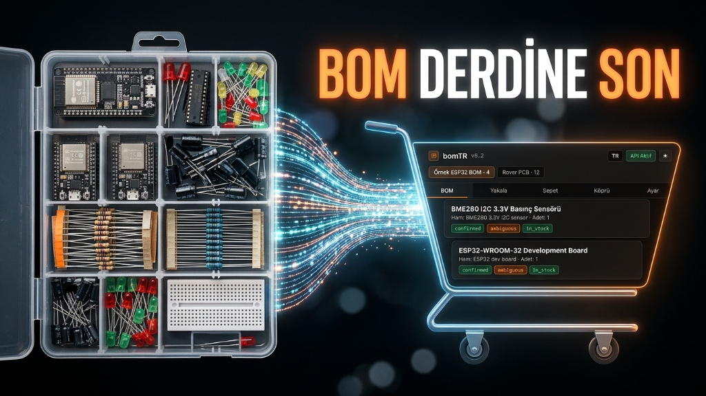
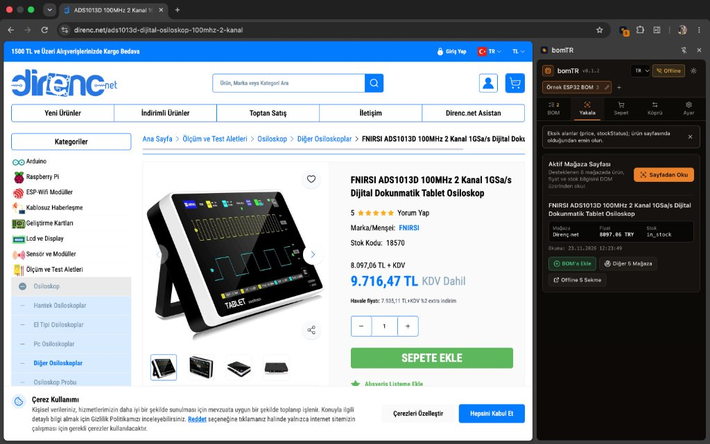
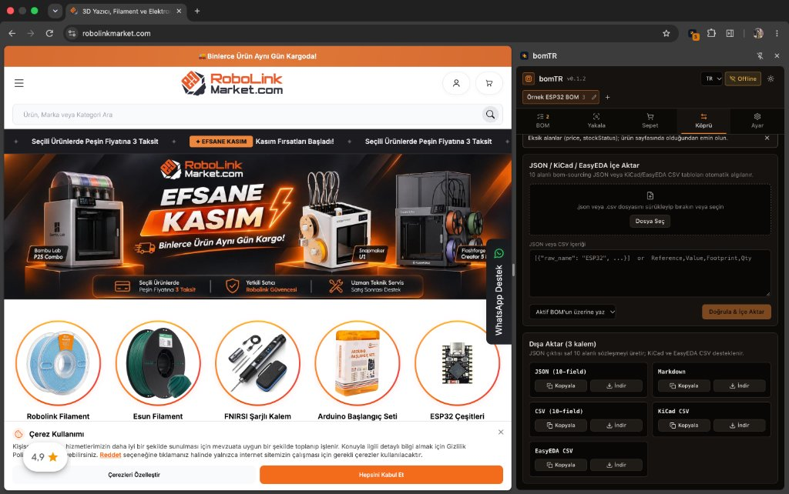
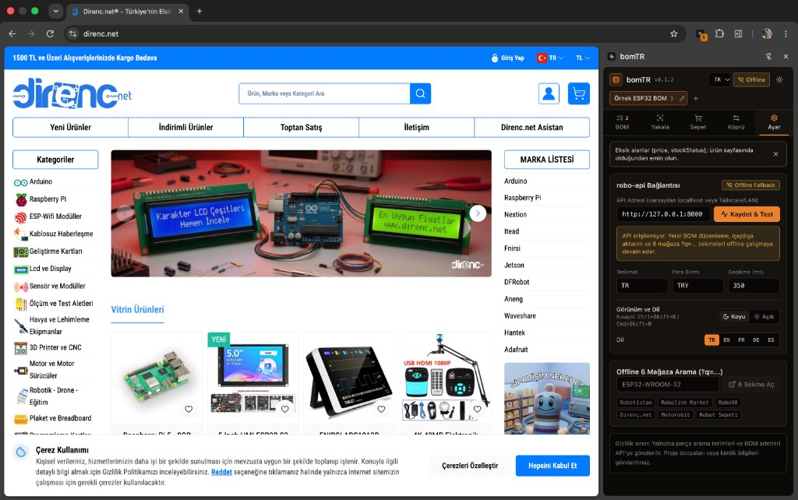
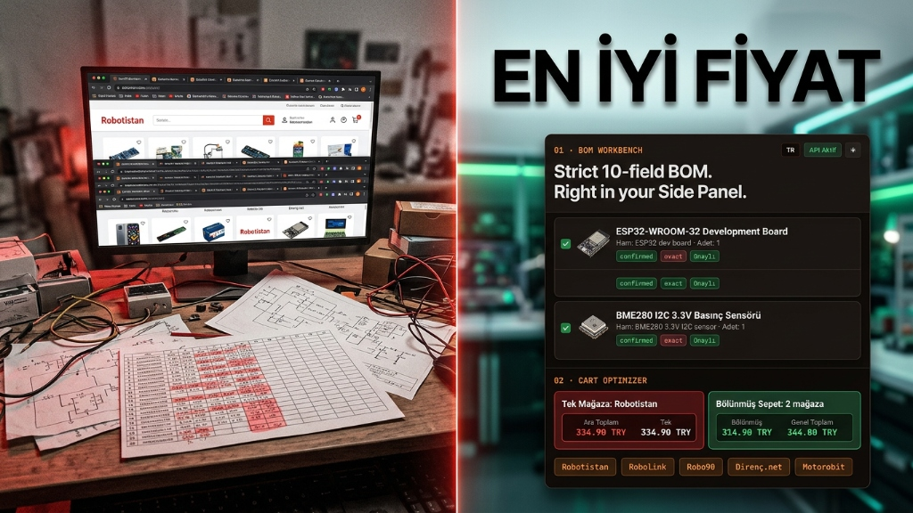
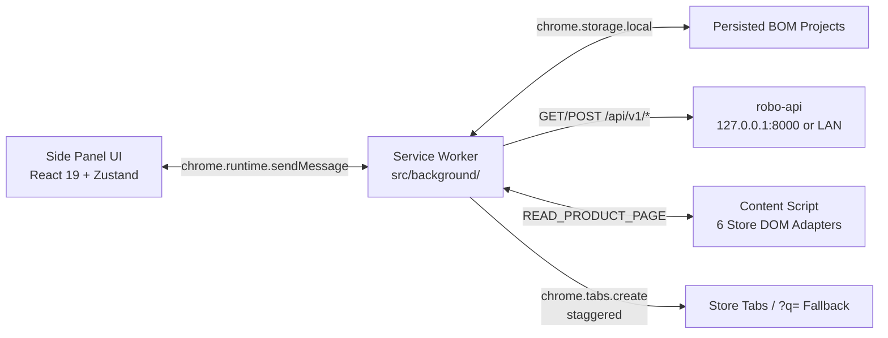

<p align="left">
  
</p>

# bomTR

[](https://github.com/AtaCanYmc/bom-tr/actions/workflows/ci.yml)
[](https://github.com/AtaCanYmc/bom-tr/releases)
[](LICENSE)
[](public/manifest.json)
[](https://www.conventionalcommits.org)

[Türkçe](README.md) | English | [Website](https://atacanymc.github.io/bom-tr/)

[](https://www.youtube.com/watch?v=l9TjYiBdo7w)

[Watch Demo Video (YouTube)](https://www.youtube.com/watch?v=l9TjYiBdo7w)

Manifest V3 Chrome Side Panel extension for managing 10-field `bom-sourcing` Bills of Materials and comparing live component prices across six Turkish electronics stores via `robo-api` or offline `?q=...` search fallback.

## Table of Contents

- [Screenshots](#screenshots)
- [Architecture](#architecture)
- [Quick Start](#quick-start)
- [Repository Layout](#repository-layout)
- [Permissions and Privacy Boundary](#permissions-and-privacy-boundary)
- [Documentation](#documentation)
- [Verification and Packaging](#verification-and-packaging)
- [Technical FAQ](#technical-faq)
- [Governance and License](#governance-and-license)

## Screenshots

| Active Store DOM Capture (`Capture`) | JSON / KiCad / EasyEDA (`Bridge`) |
| :---: | :---: |
|  |  |

| Settings, 5 Languages & Offline Search (`Settings`) | Single vs Split Cart Overview |
| :---: | :---: |
|  |  |

## Architecture

The extension isolates the Side Panel UI, the background Service Worker, and 6 store-scoped Content Script DOM adapters. Observed candidate prices and stock evidence are stored outside the strict 10-field `BomItem` contract.



## Quick Start

```bash
make install
make verify
```

### Load in Chrome (`Load unpacked`)

1. Run `make build` (or `npm run build`) to generate the `dist/` bundle.
2. Open `chrome://extensions` in Chrome and enable **Developer mode**.
3. Click **Load unpacked** and select the `dist/` directory.
4. Click the **bomTR** toolbar icon to open the Side Panel.

## Repository Layout

```text
bom-tr/
├── .github/
│   ├── ISSUE_TEMPLATE/       # Bug report, feature request, and config.yaml
│   ├── PULL_REQUEST_TEMPLATE/# PR verification checklist
│   ├── workflows/
│   │   ├── ci.yml            # Version, typecheck, test, build, and doc link checks
│   │   ├── pages.yml         # Deploys site/ to GitHub Pages
│   │   └── release-please.yml# Automated versioning and Chrome ZIP release uploads
│   ├── CODEOWNERS            # Review routing rules
│   └── dependabot.yml        # Weekly npm and GitHub Actions updates
├── docs/
│   ├── assets/               # Screenshots and release banners
│   ├── README.md             # Documentation index
│   ├── architecture.md       # MV3 layers, message flow, and DOM adapter isolation
│   ├── bom-contract.md       # 10-field BOM contract, KiCad/EasyEDA CSV, and export formats
│   ├── privacy.md            # Chrome Web Store privacy policy and local-first data boundary
│   └── robo-api.md           # REST endpoints, shipping defaults, and offline fallback
├── public/
│   ├── icons/                # 16px, 48px, 128px extension icons
│   └── manifest.json         # Manifest V3 config with minimum permissions
├── site/
│   ├── .nojekyll             # Disables Jekyll processing on GitHub Pages
│   └── index.html            # GitHub Pages landing and download site
├── src/
│   ├── background/
│   │   ├── index.ts          # Service worker, context menu, badge, staggered tabs
│   │   ├── roboApi.ts        # robo-api HTTP client and single vs split cart calculator
│   │   └── storageKeys.ts    # chrome.storage.local key constants
│   ├── content/
│   │   ├── adapters.ts       # Isolated DOM adapters for 6 Turkish stores
│   │   ├── index.ts          # Content script message handler
│   │   └── parser.ts         # JSON-LD reader, Turkish price parser, stock classifier
│   ├── shared/
│   │   ├── bom.ts            # 10-field BomItem contract, candidate evidence, project types
│   │   ├── exporters.ts      # Pure 10-field JSON, Markdown, CSV, and KiCad/EasyEDA CSV codecs
│   │   ├── i18n.ts           # TR, EN, FR, DE, ES localization dictionary
│   │   ├── messages.ts       # Typed extension message contracts
│   │   ├── stores.ts         # 6 store definitions, shipping defaults, URL sanitizer, ?q= URLs
│   │   └── validator.ts      # Runtime 10-field bom-sourcing JSON validator
│   └── sidepanel/
│       ├── components/       # BomTab, CaptureCompareTab, CartTab, BridgeTab, SettingsTab
│       ├── App.tsx           # Side panel shell and multi-project tabs
│       ├── chromeBridge.ts   # Typed chrome.* runtime, storage, and origin permission wrapper
│       ├── index.css         # Tailwind CSS entry
│       ├── main.tsx          # React 19 entry point
│       └── store.ts          # Zustand state persisted to chrome.storage.local
├── tests/
│   ├── fixtures/             # Saved HTML snapshots for all 6 Turkish electronics stores
│   ├── bom.test.ts           # Schema, KiCad/EasyEDA CSV, adapter, security, and cart tests
│   └── domFixture.ts         # Zero-dependency HTML DOM query shim for Node tests
├── .editorconfig
├── .gitattributes
├── .markdownlint.json
├── .release-please-manifest.json
├── CHANGELOG.md
├── CHROMEWEBSTORE.md
├── CONTRIBUTING.md
├── LICENSE
├── Makefile
├── README.md
├── ROADMAP.md
├── SECURITY.md
├── release-please-config.json
├── sidepanel.html
├── tsconfig.json
├── vite.config.ts
└── vite.content.config.ts
```

## Permissions and Privacy Boundary

| Permission / Host | Purpose |
| :--- | :--- |
| `sidePanel` | Opens the primary bomTR workspace on toolbar click and context menu action. |
| `storage` | Persists multi-project BOM state and settings in `chrome.storage.local`. |
| `contextMenus` | Provides the "bomTR: BOM'a Ekle" right-click action for selections and product pages. |
| `activeTab` | Grants temporary tab access on explicit context menu actions without broad tab permissions. |
| 6 store hosts | Scoped DOM capture on Robotistan, Robolink Market, Robo90, Direnç.net, Motorobit, and Robot Sepeti. |
| `http://127.0.0.1/*`, `http://localhost/*` | Connects to a local `robo-api` server. Custom Tailscale/LAN URLs request per-origin permission on click via `optional_host_permissions`. |

Only sanitized component search queries and BOM item quantities are sent to `robo-api`. Project files, credentials, and unrelated page content are never transmitted.

## Documentation

- [Documentation Index](docs/README.md)
- [Architecture and Message Flow](docs/architecture.md)
- [10-Field BOM Contract](docs/bom-contract.md)
- [robo-api and Offline Fallback](docs/robo-api.md)
- [Privacy Policy](docs/privacy.md)

## Verification and Packaging

```bash
make typecheck     # TypeScript strict check
make test          # Schema validation, exporter, price parser, and cart math checks
make build         # Production MV3 bundle to dist/
make release-dry   # Full verification + Chrome ZIP archive and SHA256SUMS
```

## Technical FAQ

### Does the extension work when `robo-api` is offline?

Yes. Local BOM editing, `bom-sourcing` JSON import and export, active-tab DOM capture on the 6 stores, and staggered `?q=...` search tabs work without an active API server.

### Why are `partial` and `ambiguous` matches never locked automatically?

Catalog search results can share a part family while differing in voltage, package, or pinout. Selections remain unlocked until the user explicitly confirms compatibility.

### How do I connect to a Tailscale or LAN `robo-api` host?

Enter the base URL in the **Settings** tab and click **Kaydet & Test**. Chrome requests scoped host permission for that specific origin via `optional_host_permissions`.

## Governance and License

- Contribution workflow: [CONTRIBUTING.md](CONTRIBUTING.md)
- Release milestones: [ROADMAP.md](ROADMAP.md)
- Security policy: [SECURITY.md](SECURITY.md)
- License: [MIT](LICENSE)
