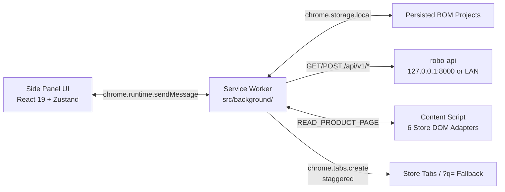

# bomTR

Manifest V3 Chrome Side Panel extension for managing 10-field `bom-sourcing` Bills of Materials and comparing live component prices across six Turkish electronics stores via `robo-api` or offline search fallback.

## Architecture



## Quick Start

```bash
npm install
npm test
npm run build
```

### Load in Chrome (`Load unpacked`)

1. Run `npm run build` to generate the `dist/` bundle.
2. Open `chrome://extensions` in Chrome and enable **Developer mode**.
3. Click **Load unpacked** and select the `dist/` directory.
4. Click the **bomTR** toolbar icon to open the Side Panel.

## Repository Layout

```text
bom-tr/
├── public/
│   ├── icons/                # 16px, 48px, 128px extension icons
│   └── manifest.json         # Manifest V3 config with minimum permissions
├── src/
│   ├── background/
│   │   ├── index.ts          # Service worker, context menu, badge, staggered tabs
│   │   ├── roboApi.ts        # robo-api HTTP client and single vs split cart calculator
│   │   └── storageKeys.ts    # chrome.storage.local key constants
│   ├── content/
│   │   ├── adapters.ts       # Isolated DOM adapters for 6 Turkish stores
│   │   ├── index.ts          # Content script message handler
│   │   └── parser.ts         # JSON-LD reader, Turkish price parser, stock classifier
│   ├── shared/
│   │   ├── bom.ts            # 10-field BomItem contract, candidate evidence, project types
│   │   ├── exporters.ts      # Pure 10-field JSON, Markdown, and CSV exporters
│   │   ├── messages.ts       # Typed extension message contracts
│   │   ├── stores.ts         # 6 store definitions, shipping defaults, ?q= URL builders
│   │   └── validator.ts      # Runtime 10-field bom-sourcing JSON validator
│   └── sidepanel/
│       ├── components/       # BomTab, CaptureCompareTab, CartTab, BridgeTab, SettingsTab
│       ├── App.tsx           # Side panel shell and multi-project tabs
│       ├── chromeBridge.ts   # Typed chrome.* runtime, storage, and origin permission wrapper
│       ├── index.css         # Tailwind CSS entry
│       ├── main.tsx          # React 19 entry point
│       └── store.ts          # Zustand state persisted to chrome.storage.local
├── tests/
│   └── bom.test.ts           # Node built-in test runner checks for schema, parser, cart math
├── sidepanel.html
├── tsconfig.json
├── vite.config.ts
└── vite.content.config.ts
```

## Permissions and Privacy Boundary

| Permission / Host | Purpose |
| :--- | :--- |
| `sidePanel` | Opens the primary bomTR workspace on toolbar click and context menu action. |
| `storage` | Persists multi-project BOM state and settings in `chrome.storage.local`. |
| `contextMenus` | Provides the "bomTR: BOM'a Ekle" right-click action for selections and product pages. |
| `activeTab` | Grants temporary tab access on explicit context menu actions without broad tab permissions. |
| 6 store hosts | Scoped DOM capture on Robotistan, Robolink Market, Robo90, Direnç.net, Motorobit, and Robot Sepeti. |
| `http://127.0.0.1/*`, `http://localhost/*` | Connects to a local `robo-api` server. Custom Tailscale/LAN URLs request per-origin permission on click via `optional_host_permissions`. |

Only sanitized component search queries and BOM item quantities are sent to `robo-api`. Project files, credentials, and unrelated page content are never transmitted.

## Verification Commands

```bash
npm run typecheck   # TypeScript strict check
npm test            # Schema validation, exporter, price parser, and cart math checks
npm run build       # Production MV3 bundle to dist/
```
