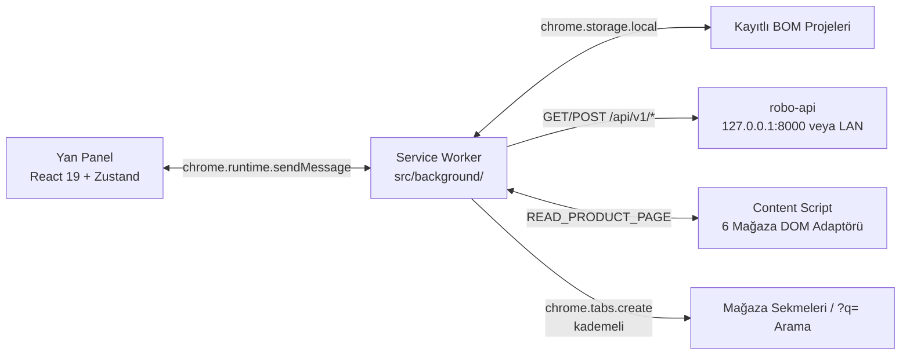

# bomTR

[](https://github.com/AtaCanYmc/bom-tr/releases)
[](LICENSE)
[](public/manifest.json)
[](https://www.conventionalcommits.org)

Türkçe | [English](README.en.md)

`bomTR`, 10 alanlı `bom-sourcing` malzeme listelerini (BOM) tarayıcı yan panelinde yönetmek ve Türkiye'deki 6 elektronik bileşen mağazasında fiyat/stok kıyaslamak için geliştirilmiş bir Chrome Manifest V3 eklentisidir. Yerel `robo-api` servisiyle çalışır; API kapalıyken de yerel düzenleme ve 6 mağazada `?q=...` arama sekmeleriyle kullanılabilir.

## İçindekiler

- [Nasıl Çalışır?](#nasıl-çalışır)
- [Kurulum ve Hızlı Başlangıç](#kurulum-ve-hızlı-başlangıç)
- [Proje Yapısı](#proje-yapısı)
- [İzinler ve Gizlilik](#izinler-ve-gizlilik)
- [Belgeler](#belgeler)
- [Doğrulama ve Paketleme](#doğrulama-ve-paketleme)
- [Sık Sorulan Sorular](#sık-sorulan-sorular)
- [Katkı ve Lisans](#katkı-ve-lisans)

## Nasıl Çalışır?

Eklenti üç ayrı katmanda çalışır: yan panel arayüzü (`src/sidepanel/`), arka plan servisi (`src/background/`) ve yalnızca 6 mağaza sayfasında çalışan DOM okuyucular (`src/content/`). Fiyat ve stok bilgileri ham BOM kayıtlarının içine gömülmez; ayrı aday listesinde tutulduğu için JSON çıktısı her zaman `bom-sourcing` şemasına birebir uyar.



## Kurulum ve Hızlı Başlangıç

```bash
make install
make verify
```

### Chrome'a Yükleme

1. `dist/` klasörünü oluşturmak için `make build` (veya `npm run build`) komutunu çalıştırın.
2. Chrome adres çubuğuna `chrome://extensions` yazın ve sağ üstten **Geliştirici modu**nu açın.
3. **Paketlenmemiş öğe yükle** seçeneğine tıklayıp `dist/` klasörünü seçin.
4. Tarayıcı araç çubuğundaki **bomTR** simgesine tıklayarak yan paneli açın.

## Proje Yapısı

```text
bom-tr/
├── .github/workflows/
│   └── release-please.yml    # Otomatik sürümleme ve ZIP sürüm yükleme akışı
├── docs/
│   ├── README.md             # Belge dizini
│   ├── architecture.md       # MV3 katmanları, mesaj akışı ve DOM adaptörleri
│   ├── bom-contract.md       # 10 alanlı BOM sözleşmesi ve dışa aktarım kuralları
│   └── robo-api.md           # API uç noktaları, kargo varsayılanları ve çevrimdışı arama
├── public/
│   ├── icons/                # 16px, 48px, 128px eklenti simgeleri
│   └── manifest.json         # Minimum izinli Manifest V3 tanımı
├── src/
│   ├── background/
│   │   ├── index.ts          # Service worker, sağ tık menüsü, rozet ve kademeli sekme açıcı
│   │   ├── roboApi.ts        # robo-api istemcisi ve tek/bölünmüş sepet hesabı
│   │   └── storageKeys.ts    # chrome.storage.local anahtar adları
│   ├── content/
│   │   ├── adapters.ts       # 6 mağaza için birbirinden bağımsız DOM adaptörleri
│   │   ├── index.ts          # Sayfa okuma mesaj dinleyicisi
│   │   └── parser.ts         # JSON-LD okuyucu, TL fiyat ayrıştırıcı ve stok algılayıcı
│   ├── shared/
│   │   ├── bom.ts            # 10 alanlı BomItem tipleri, aday kanıt ve proje modelleri
│   │   ├── exporters.ts      # Saf 10 alanlı JSON, Markdown ve CSV dışa aktarıcılar
│   │   ├── messages.ts       # Katmanlar arası mesaj tipleri
│   │   ├── stores.ts         # 6 mağaza tanımı, kargo eşikleri ve ?q= arama adresleri
│   │   └── validator.ts      # 10 alanlı bom-sourcing JSON doğrulayıcısı
│   └── sidepanel/
│       ├── components/       # BomTab, CaptureCompareTab, CartTab, BridgeTab, SettingsTab
│       ├── App.tsx           # Yan panel ana ekranı ve çoklu proje sekmeleri
│       ├── chromeBridge.ts   # chrome.* mesaj, depolama ve alan adı izin yardımcıları
│       ├── index.css         # Tailwind CSS girişi
│       ├── main.tsx          # React 19 giriş noktası
│       └── store.ts          # chrome.storage.local ile kalıcı Zustand deposu
├── tests/
│   └── bom.test.ts           # Şema, dışa aktarım, fiyat ayrıştırma ve sepet hesabı testleri
├── .release-please-manifest.json
├── CONTRIBUTING.md
├── LICENSE
├── Makefile
├── README.en.md
├── SECURITY.md
├── release-please-config.json
├── sidepanel.html
├── tsconfig.json
├── vite.config.ts
└── vite.content.config.ts
```

## İzinler ve Gizlilik

| İzin / Alan Adı | Ne İçin Kullanılır? |
| :--- | :--- |
| `sidePanel` | Araç çubuğu simgesi ve sağ tık menüsüyle bomTR yan panelini açar. |
| `storage` | Çoklu proje BOM listelerini ve ayarları tarayıcıda (`chrome.storage.local`) saklar. |
| `contextMenus` | Seçili metni veya açık ürün sayfasını doğrudan listeye eklemek için "bomTR: BOM'a Ekle" seçeneğini sunar. |
| `activeTab` | Geniş sekme izni istemeden yalnızca sağ tık anında aktif sekmeye geçici erişim verir. |
| 6 mağaza alan adı | Robotistan, Robolink Market, Robo90, Direnç.net, Motorobit ve Robot Sepeti sayfalarından ürün bilgisi okur. |
| `http://127.0.0.1/*`, `http://localhost/*` | Yerel `robo-api` sunucusuna bağlanır. Farklı bir LAN veya Tailscale adresi girilirse yalnızca o adres için ayrıca izin istenir. |

`robo-api` servisine yalnızca parça arama terimleri ve BOM adetleri gider. Proje dosyaları, kimlik bilgileri veya ilgisiz sekme içerikleri hiçbir zaman dışarıya gönderilmez.

## Belgeler

- [Belge Dizini](docs/README.md)
- [Mimari ve Mesaj Akışı](docs/architecture.md)
- [10 Alanlı BOM Sözleşmesi](docs/bom-contract.md)
- [robo-api ve Çevrimdışı Kullanım](docs/robo-api.md)

## Doğrulama ve Paketleme

```bash
make typecheck     # TypeScript strict tip kontrolü
make test          # Birim ve sözleşme testleri
make build         # dist/ klasörüne üretim derlemesi
make release-dry   # Tüm kontroller + Chrome ZIP paketi ve SHA256SUMS
```

## Sık Sorulan Sorular

### `robo-api` kapalıyken eklenti işe yarar mı?

Evet. BOM düzenleme, `bom-sourcing` JSON içe/dışa aktarma, desteklenen 6 mağazadan ürün okuma ve seçilen parçayı 6 mağazada `?q=...` ile tek tıkla aratma özellikleri API olmadan da çalışır.

### `partial` veya `ambiguous` eşleşmeler neden otomatik kilitlenmiyor?

Aynı isimle aranan parçalar farklı voltaj, kılıf veya pin dizilimine sahip olabiliyor. Yanlış bileşen siparişini önlemek için kullanıcı açıkça **Onayla** demeden seçim kilitlenmez ve `exact` yapılmaz.

### Yerel ağdaki veya Tailscale üzerindeki `robo-api` sunucusuna nasıl bağlanırım?

**Ayar** sekmesine sunucu adresini yazıp **Kaydet & Test** düğmesine basın. Chrome yalnızca o adres için tek seferlik erişim onayı ister.

## Katkı ve Lisans

- Katkı ve PR kuralları için [CONTRIBUTING.md](CONTRIBUTING.md) dosyasına bakın.
- Güvenlik bildirimi için [SECURITY.md](SECURITY.md) dosyasını inceleyin.
- Proje [MIT](LICENSE) lisansıyla yayımlanmıştır.
