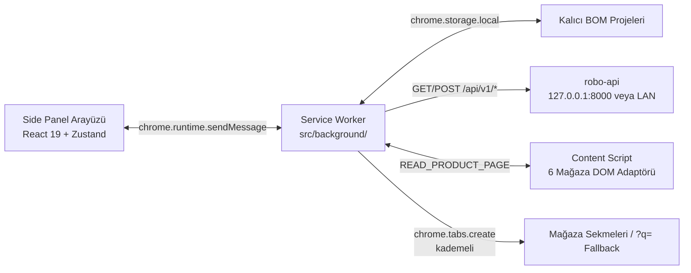

# bomTR

[](https://github.com/AtaCanYmc/bom-tr/releases)
[](LICENSE)
[](public/manifest.json)
[](https://www.conventionalcommits.org)

Türkçe | [English](README.en.md)

10 alanlı `bom-sourcing` BOM (Bill of Materials) şemasını yönetmek ve Türkiye'deki 6 elektronik bileşen mağazasında `robo-api` veya çevrimdışı `?q=...` aramasıyla fiyat ve stok kıyaslamak için Manifest V3 Chrome Side Panel eklentisi.

## İçindekiler

- [Mimari](#mimari)
- [Hızlı Başlangıç](#hızlı-başlangıç)
- [Depo Yapısı](#depo-yapısı)
- [İzinler ve Gizlilik Sınırı](#izinler-ve-gizlilik-sınırı)
- [Dokümantasyon](#dokümantasyon)
- [Doğrulama ve Paketleme](#doğrulama-ve-paketleme)
- [Sık Sorulan Teknik Sorular](#sık-sorulan-teknik-sorular)
- [Yönetişim ve Lisans](#yönetişim-ve-lisans)

## Mimari

Eklenti, Side Panel arayüzünü arka plan Service Worker'ından ve 6 mağazaya izole edilmiş Content Script adaptörlerinden ayırır. Aday fiyat ve stok kanıtları, 10 alanlı ham BOM nesnesini bozmadan ayrı tutulur.



## Hızlı Başlangıç

```bash
make install
make verify
```

### Chrome'da Yükleme (`Load unpacked`)

1. `dist/` çıktısını üretmek için `make build` (veya `npm run build`) çalıştırın.
2. Chrome'da `chrome://extensions` sayfasını açın ve **Geliştirici modu**nu etkinleştirin.
3. **Paketlenmemiş öğe yükle** (`Load unpacked`) düğmesine tıklayıp `dist/` klasörünü seçin.
4. Araç çubuğundaki **bomTR** ikonuna tıklayarak Side Panel çalışma alanını açın.

## Depo Yapısı

```text
bom-tr/
├── .github/workflows/
│   └── release-please.yml    # Otomatik sürümleme ve Chrome ZIP sürüm yüklemesi
├── docs/
│   ├── README.md             # Dokümantasyon dizini
│   ├── architecture.md       # MV3 katmanları, mesaj akışı ve DOM adaptörleri
│   ├── bom-contract.md       # 10 alanlı BOM sözleşmesi ve dışa aktarım biçimleri
│   └── robo-api.md           # REST uç noktaları, kargo varsayılanları ve offline fallback
├── public/
│   ├── icons/                # 16px, 48px, 128px eklenti ikonları
│   └── manifest.json         # Minimum izinli Manifest V3 tanımı
├── src/
│   ├── background/
│   │   ├── index.ts          # Service worker, sağ tık menüsü, rozet, kademeli sekme açıcı
│   │   ├── roboApi.ts        # robo-api HTTP istemcisi ve tek/bölünmüş sepet hesaplayıcı
│   │   └── storageKeys.ts    # chrome.storage.local anahtar sabitleri
│   ├── content/
│   │   ├── adapters.ts       # 6 Türk mağazası için izole DOM adaptörleri
│   │   ├── index.ts          # Content script mesaj dinleyicisi
│   │   └── parser.ts         # JSON-LD okuyucu, TL fiyat ayrıştırıcı, stok sınıflandırıcı
│   ├── shared/
│   │   ├── bom.ts            # 10 alanlı BomItem sözleşmesi, aday kanıt ve proje tipleri
│   │   ├── exporters.ts      # Saf 10 alan JSON, Markdown ve CSV dışa aktarıcılar
│   │   ├── messages.ts       # Tipli eklenti mesaj sözleşmeleri
│   │   ├── stores.ts         # 6 mağaza tanımı, kargo varsayılanları, ?q= URL üreticileri
│   │   └── validator.ts      # Çalışma zamanı 10 alan bom-sourcing JSON doğrulayıcısı
│   └── sidepanel/
│       ├── components/       # BomTab, CaptureCompareTab, CartTab, BridgeTab, SettingsTab
│       ├── App.tsx           # Side panel kabuğu ve çoklu proje sekmeleri
│       ├── chromeBridge.ts   # Tipli chrome.* runtime, storage ve origin izin sarmalayıcısı
│       ├── index.css         # Tailwind CSS giriş dosyası
│       ├── main.tsx          # React 19 giriş noktası
│       └── store.ts          # chrome.storage.local kalıcılıklı Zustand store
├── tests/
│   └── bom.test.ts           # Node yerleşik test koşucusu ile şema, parser ve sepet testleri
├── .release-please-manifest.json
├── CONTRIBUTING.md
├── LICENSE
├── Makefile
├── README.en.md
├── SECURITY.md
├── release-please-config.json
├── sidepanel.html
├── tsconfig.json
├── vite.config.ts
└── vite.content.config.ts
```

## İzinler ve Gizlilik Sınırı

| İzin / Alan Adı | Amaç |
| :--- | :--- |
| `sidePanel` | Araç çubuğu tıklaması ve sağ tık menüsüyle bomTR çalışma alanını açar. |
| `storage` | Çoklu proje BOM verilerini ve ayarları `chrome.storage.local` üzerinde saklar. |
| `contextMenus` | Seçili metin ve ürün sayfaları için "bomTR: BOM'a Ekle" sağ tık aksiyonunu ekler. |
| `activeTab` | Geniş sekme izni olmadan yalnızca sağ tık aksiyonunda geçici sekme erişimi sağlar. |
| 6 mağaza alan adı | Robotistan, Robolink Market, Robo90, Direnç.net, Motorobit ve Robot Sepeti üzerinde kısıtlı DOM okuma. |
| `http://127.0.0.1/*`, `http://localhost/*` | Yerel `robo-api` sunucusuna bağlanır. Özel Tailscale/LAN adresleri için `optional_host_permissions` ile yalnızca ilgili origin izni istenir. |

`robo-api` servisine yalnızca temizlenmiş parça arama terimleri ve BOM kalem adetleri gönderilir. Proje dosyaları, kimlik bilgileri veya ilgisiz sayfa içerikleri asla gönderilmez.

## Dokümantasyon

- [Dokümantasyon Dizini](docs/README.md)
- [Mimari ve Mesaj Akışı](docs/architecture.md)
- [10 Alanlı BOM Sözleşmesi](docs/bom-contract.md)
- [robo-api ve Offline Fallback](docs/robo-api.md)

## Doğrulama ve Paketleme

```bash
make typecheck     # TypeScript strict tip kontrolü
make test          # Şema doğrulama, exporter, fiyat ayrıştırıcı ve sepet hesap testleri
make build         # dist/ altına üretim MV3 derlemesi
make release-dry   # Tam doğrulama + Chrome ZIP arşivi ve SHA256SUMS
```

## Sık Sorulan Teknik Sorular

### `robo-api` kapalıyken eklenti çalışır mı?

Evet. Yerel BOM düzenleme, `bom-sourcing` JSON içe ve dışa aktarım, aktif mağaza sayfasından DOM yakalama ve 6 mağazanın `?q=...` arama sekmelerini açma işlevleri API olmadan çalışmaya devam eder.

### `partial` veya `ambiguous` eşleşmeler neden otomatik kilitlenmiyor?

Otomatik katalog araması aynı addaki farklı voltaj, paket veya pin dizilimine sahip bileşenleri döndürebilir. Bu nedenle kullanıcı açıkça **Onayla** düğmesine basana kadar seçim kilitlenmez ve `exact` durumuna yükseltilmez.

### Tailscale veya yerel ağdaki bir `robo-api` sunucusuna nasıl bağlanılır?

**Ayar** sekmesinde sunucu adresini girip **Kaydet & Test** düğmesine basın. Chrome, `optional_host_permissions` üzerinden yalnızca o origin için izin ister.

## Yönetişim ve Lisans

- Katkı ve PR kuralları: [CONTRIBUTING.md](CONTRIBUTING.md)
- Güvenlik politikası: [SECURITY.md](SECURITY.md)
- Lisans: [MIT](LICENSE)
