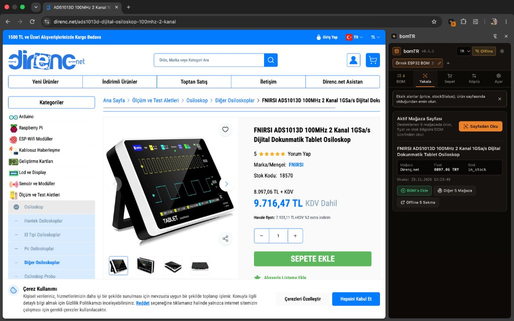
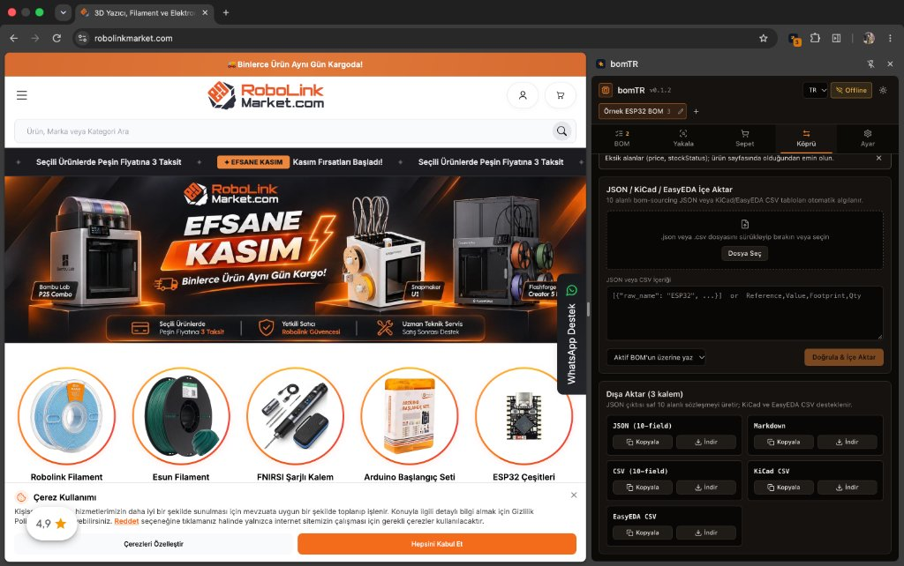
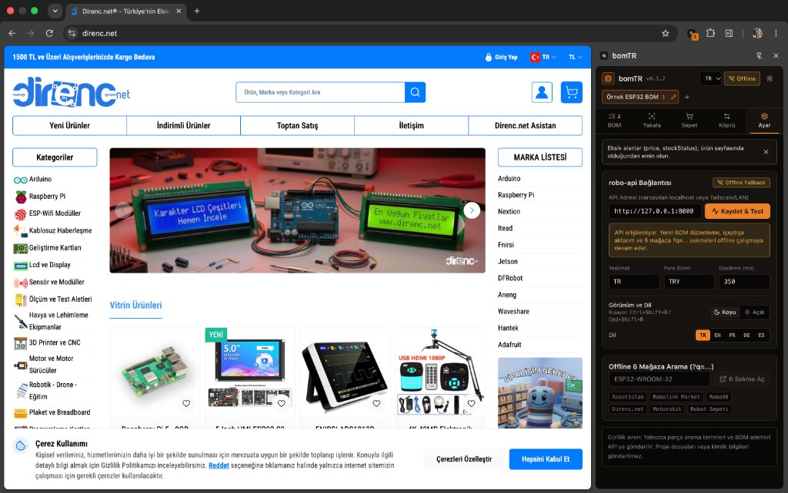

[← Ana Sayfa](../README.md) | [English README](../README.en.md) | [Web Sitesi](https://atacanymc.github.io/bom-tr/)

# bomTR Dokümantasyon

`bomTR` Chrome Manifest V3 eklentisinin teknik mimari, veri sözleşmesi ve `robo-api` entegrasyon kılavuzları.

## Kılavuzlar

| Belge | Kapsam |
| :--- | :--- |
| [Mimari ve Mesaj Akışı](architecture.md) | MV3 katmanları, Service Worker, `chrome.storage.local`, izole 6 mağaza DOM adaptörleri ve kademeli sekme açma. |
| [10 Alanlı BOM Sözleşmesi](bom-contract.md) | `bom-sourcing` şeması, çalışma alanı aday kanıtlarının ayrıştırılması, onay kilidi ve dışa aktarım biçimleri. |
| [robo-api ve Offline Fallback](robo-api.md) | REST uç noktaları, tek/bölünmüş sepet hesabı, Tailscale/LAN origin izni ve 6 mağaza `?q=` araması. |

## Yönetişim Belgeleri

| Belge | Kapsam |
| :--- | :--- |
| [SECURITY.md](../SECURITY.md) | Desteklenen sürümler, gizlilik sınırı, izin gerekçeleri ve güvenlik bildirimi. |
| [Gizlilik Politikası](privacy.md) | Yerel depolama, API veri sınırı ve Chrome Web Store gizlilik beyanı. |
| [CONTRIBUTING.md](../CONTRIBUTING.md) | Geliştirme akışı, Conventional Commits kuralları ve PR doğrulama adımları. |
| [ROADMAP.md](../ROADMAP.md) | Sürüm hedeflerine göre planlanan teknik teslimatlar. |
| [CHROMEWEBSTORE.md](../CHROMEWEBSTORE.md) | Chrome Web Store mağaza metinleri, izin gerekçeleri ve görsel kontrol listesi. |
| [CHANGELOG.md](../CHANGELOG.md) | Sürümlere göre değişiklik günlüğü. |
| [LICENSE](../LICENSE) | MIT lisans metni. |

## Görseller

| Yakalama | Köprü | Ayarlar |
| :---: | :---: | :---: |
|  |  |  |
