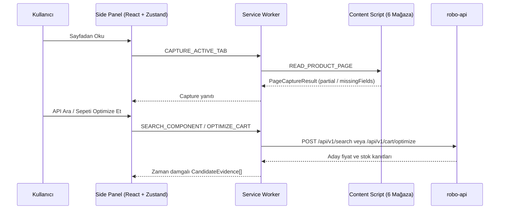

[← Dokümantasyon](README.md)

# Mimari ve Mesaj Akışı

`bomTR` üç izole Manifest V3 çalışma ortamından oluşur: Side Panel arayüzü (`src/sidepanel/`), arka plan Service Worker (`src/background/`) ve yalnızca 6 hedef mağazada çalışan Content Script (`src/content/`).

## Katman Etkileşimi

## Kalıcı Durum ve Service Worker Yaşam Döngüsü

- Service Worker (`src/background/index.ts`) global bellek değişkenlerinde kalıcı durum tutmaz.
- Tüm çoklu proje BOM verileri ve kullanıcı ayarları `chrome.storage.local` altında `bomtr:workspace:v1` anahtarında saklanır.
- Sağ tık menüsünden (`bomtr-add-to-bom`) yakalanan seçili metin veya mağaza ürünü `bomtr:pending-context-item:v1` anahtarına yazılır, ikon rozeti `+1` ile güncellenir ve Side Panel açıldığında tüketilir.

## İzole DOM Adaptörleri ve Hata Toleransı

`src/content/adapters.ts` her mağaza için ayrı CSS seçici kümesi tanımlar ve üç katmanlı okuma uygular:

1. `script[type="application/ld+json"]` içindeki `Product` ve `Offer` düğümleri.
2. Mağazaya özel CSS seçicileri (başlık, fiyat, stok sinyali, SKU).
3. `og:title` ve `product:price:amount` meta etiketleri.

Seçiciler eşleşmezse uydurma değer üretilmez. Eksik alanlar `null` veya `unknown` olarak döner, `missingFields` dizisine eklenir ve `partial: true` bayrağı işaretlenir.

## Kontrollü Toplu Sekme Açma

`OPEN_TABS_STAGGERED` mesajı yalnızca `http:` ve `https:` şemalarını kabul eder, tek seferde en fazla `12` sekme açar ve sekmeler arasında yapılandırılabilir gecikme (`150 ms` ile `2000 ms` arası, varsayılan `350 ms`) uygular.
